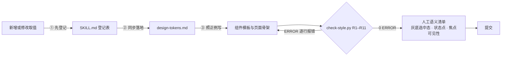

<!-- chatgptfrontend-style-guard · README（中文）· 文档版本 v3 · 对应规范版本 v2.2 · 2026-11-06 -->

# chatgptfrontend-style-guard

> **前端风格守门技能 —— 让 AI 写出的每一行样式，都有据可查、有门可守。**

[中文](README.md) · [English](README_EN.md)

    

**openaistack-frontend-style**（风格名 **OpenaiStack**）—— 一份 UI 设计规范，做成 AI 智能体可执行、机器可审查的技能包。适用于 HTML / CSS / TS / JS / Vue / React 全栈前端开发。

---

## 目录

- [为什么需要它](#为什么需要它)
- [60 秒看懂](#60-秒看懂)
- [快速开始](#快速开始)
- [一行命令安装到你的 Agent](#一行命令安装到你的-agent)
- [永久设定 Agent 的开发设计风格](#永久设定-agent-的开发设计风格)
- [看它工作：一个真实的例子](#看它工作一个真实的例子)
- [目录结构](#目录结构)
- [设计令牌速览](#设计令牌速览)
- [审查规则 R1–R11](#审查规则-r1r11)
- [上下文成本](#上下文成本)
- [FAQ](#faq)
- [版本历史](#版本历史)
- [许可与致谢](#许可与致谢)

## 为什么需要它

让 AI 写前端，十次有九次会**字面量漂移**：这一轮它记得主色用令牌，下一轮就顺手写出 `#4b5563`；这次间距守着网格，下次就来一个 `padding: 18px`。"在提示词里强调一下"守不住——因为提示词是概率性约束，违规率随轮次累积。

OpenaiStack 把风格规范从"提示词约束"升级为三层机制：

1. **登记制**：`SKILL.md` §一是全部 Token 的唯一真相源。组件代码禁止任何字面量；新增取值必须**先登记、再落地、再使用**，否则审查器一律拦截。
2. **确定性守门**：`scripts/check-style.py`（R1–R11）在提交前逐行扫描机械项——颜色、间距、圆角、字号、时长、层级、Token 引用，检出率不依赖模型自觉。
3. **正例锚点**：13 类组件模板 + 5 种页面骨架 + 全量测试页。AI 每次生成都有合规参照，而不是只有一张"禁止清单"。

而且，规范里的每一个数值都不是拍脑袋定的——全部**实测提取自 KnowWork v0.0.2 前端源码与编译产物**（底座为 OpenAI 开源的 ChatGPT 设计系统 `@openai/apps-sdk-ui`），证据链见 `references/knowwork-analysis.md`。

## 60 秒看懂



一句话：**登记处定义什么是合法，审查器保证必然查出非法，模板让 AI 一次写对。**

## 快速开始

### 方式一：让 AI 智能体按本规范开发（推荐）

把整个目录交给任意 AI 智能体（Claude / GPT / TeleAgent / Cursor 均可），用两段提示词驱动：

**开发新组件 / 页面：**

```text
先阅读项目根目录 SKILL.md，本次任务的所有样式必须严格遵循 OpenaiStack 风格。
本次任务：[填写具体任务]。
完成后运行 python scripts/check-style.py 验证 0 ERROR，并附 Token 使用报告。
```

**提交前审查：**

```text
请先运行 python scripts/check-style.py <改动目录>，修复所有 ERROR 并逐条确认 INFO；
再对照 SKILL.md §五第二步审语义项（灰底选中态 / 状态点 / 层级 / 焦点 / 卡片嵌套），
修复后列出全部修复项。
```

### 方式二：人工工作流

```bash
# 提交前审查（存在 ERROR 时退出码 1，可直接接 CI / pre-commit）
python scripts/check-style.py .

# 预览金样例（全量测试页：色板 / 组件 / 排版 / 浮层 / 动效 / 明暗主题 / 扩展名图标测试器）
# 双击打开 demo/openaistack-v2-test.html
```

### 接入真实工程

见 `references/framework-adapters.md`：

- **React**：直接安装 `@openai/apps-sdk-ui`（路线 A，令牌与组件即开即用）；
- **Tailwind v4 / Vue**：按 `references/design-tokens.md` 路线 B 的 `@theme inline` 落地；
- **纯 HTML/CSS**：复制路线 B 变量，手写类只引用 `var()`。

## 一行命令安装到你的 Agent

本仓库已按 [Agent Skills 开放规范](https://agentskills.io) 打包（根目录带标准 `SKILL.md` front-matter），用 Vercel 的 `skills` CLI 一行拉取（需 Node.js 22.20+）：

```bash
# 装到当前项目（推荐）；-a 指定目标 Agent，可多选
npx skills add Shawn-1211/chatgptfrontend-style-guard -a claude-code -a codex -a cursor

# 装到全局（跨项目可用）
npx skills add Shawn-1211/chatgptfrontend-style-guard -g

# 不带 -a：自动检测本机已装的 Agent 并让你勾选
npx skills add Shawn-1211/chatgptfrontend-style-guard
```

支持 Claude Code、Codex、Cursor、OpenCode、Gemini CLI、GitHub Copilot 等 75+ Agent（完整清单与安装路径见 [vercel-labs/skills](https://github.com/vercel-labs/skills)）。安装后对 Agent 说「按 OpenaiStack 风格写」「跑一下 check-style」即可触发。

常用管理命令：`npx skills list`（查看已装）/ `npx skills check`（检查更新）/ `npx skills update`（更新）/ `npx skills remove`（卸载）。

## 永久设定 Agent 的开发设计风格

技能装好后只是「可触发」；要让 Agent **每个项目、每次写前端都强制走本规范**，把下面的声明写进对应 Agent 的指令文件（各家的“永久记忆”入口）：

| Agent | 指令文件 | 作用范围 |
| --- | --- | --- |
| Claude Code | 项目根 `CLAUDE.md` / 全局 `~/.claude/CLAUDE.md` | 本项目 / 所有项目 |
| Codex | 项目根 `AGENTS.md` / 全局 `~/.codex/AGENTS.md` | 本项目 / 所有项目 |
| Cursor | 项目 `.cursor/rules/*.mdc` / 全局 Rules 设置 | 本项目 / 所有项目 |
| OpenCode | 项目根 `AGENTS.md` | 本项目 |
| TeleAgent | 复制整个目录到技能目录（见 FAQ Q6） | 全局自动触发 |

声明内容（直接复制）：

```markdown
## 前端样式规范（OpenaiStack）

本项目所有前端代码必须遵循 OpenaiStack 风格规范（chatgptfrontend-style-guard）：

1. 开发前先读项目根目录 `SKILL.md`（Token 与规则的唯一事实源）；
2. 样式只用登记 Token / Tailwind 语义类名，禁止硬编码 Hex、未登记间距/圆角/字号/时长/z-index；
3. 提交前运行 `python scripts/check-style.py <改动目录>`，必须 0 ERROR；
4. 新增取值先登记 `SKILL.md` §一 → 同步 `references/design-tokens.md` → 再使用。
```

写入后 Agent 会在每次前端任务自动加载规范——不再需要在提示词里反复强调，也不怕多轮对话后风格漂移。

## 看它工作：一个真实的例子

AI 顺手写出这样一段代码（很典型的一轮漂移）：

```html
<div class="shadow-lg duration-300" style="color:#4b5563; padding:18px; border-radius:15px; z-index:99">
  <span class="text-3xl">标题</span>
</div>
```

跑 `python scripts/check-style.py`，**真实输出**（下面是审查器实际运行结果，不是示意）：

```text
demo/example.html:2  [ERROR] [R1-硬编码颜色] #4b5563 → 替换为 SKILL.md §一 语义类名/Token
demo/example.html:2  [ERROR] [R2-间距网格] padding: 18px，不在 4px 网格登记档（或 0/auto）
demo/example.html:2  [ERROR] [R3-圆角白名单] border-radius: 15px，只允许登记档 2/4/6/8/10/12/16/20/24
demo/example.html:2  [ERROR] [R7-阴影体系] shadow-lg 未登记；只允许 shadow-100/200/300/400（浮层）或 shadow-none
demo/example.html:2  [ERROR] [R9-时长档] duration-300 未登记；时长档仅 150/160/180/200/220/350ms
demo/example.html:2  [ERROR] [R10-层级白名单] z-index: 99 未登记；层级档仅 1000(遮罩)/1001(对话框·抽屉)/1100(菜单·气泡)/2000(轻提示)
demo/example.html:3  [ERROR] [R5-字号分级] text-3xl 超出登记档（UI 允许 xs/sm/base/lg/xl/2xl，标题用登记 px 值）
```

7 处违规、逐行定位、每条带修复方向。改成登记值后 0 ERROR：

```html
<div class="rounded-lg border border-border bg-surface p-4 duration-150" style="z-index: 1100">
  <span class="text-xl text-foreground">标题</span>
</div>
```

修复后的每个取值（圆角 10、边框 alpha、内边距 16、时长 150、层级 1100、字号 20）都能在 `SKILL.md` §一找到登记行——**这就是"有据可查"的含义**。

## 目录结构

```
chatgptfrontend-style-guard/
├── SKILL.md                       # 唯一真相源：YAML 声明 + Token 登记表 + 规则 + 自查清单
├── README.md                      # 本文档
├── README_EN.md                   # 英文说明
├── LICENSE                        # MIT 许可证
├── references/
│   ├── knowwork-analysis.md       # 实测证据：架构、全部 Token 值、v1→v2 差异、处置记录
│   ├── design-tokens.md          # Token 落地：路线 A/B、语义类名速查
│   ├── component-library.md       # v2 组件模板 ×13 类
│   ├── page-templates.md          # v2 页面骨架 ×5 种
│   └── framework-adapters.md     # React/Vue/纯 HTML 适配 + 文件图标注册表（§7）
├── scripts/
│   └── check-style.py            # 确定性审查器 R1–R11（纯标准库，零依赖）
└── demo/
    └── openaistack-v2-test.html    # v2 金样例兼全量测试页（双击预览）
```

## 设计令牌速览（v2）

| 维度 | 登记值 |
| --- | --- |
| 中性灰阶 | 纯灰阶 16 档，亮 `#ffffff→#0d0d0d`，暗色整阶倒置；**边框走 alpha**（黑 5%/10%/15%，暗色白） |
| 主按钮 | 黑 `#181818`（暗色主题自动反转白底黑字）；soft 次按钮 `#ededed` |
| 语义色 | info `#0285ff` · success `#00a240` · danger `#e02e2a` · warning `#e25507` · discovery 紫 `#924ff7` · link `#2b7de9` |
| 侧边栏 | 260px（折叠 60px）；**选中态 = 浅灰底、禁止彩色实底**；左下角 = 用户菜单（设置藏在菜单内） |
| 圆角 | 2/4/6/8/10/12/16/20/24 + full（控件 8、卡片 12、弹窗 16、徽章 4） |
| 间距 | 4px 基准网格 + 半档 6/10/14 + 微间距 2/3 |
| 字号 | UI 档 12/13/**14（基准）**/15/16/18/20 + 标题档 24–72 |
| 阴影 | elevation 100–400 + hairline 发丝描边；卡片无阴影靠 alpha 边框分层 |
| 动效 | 默认 150ms；浮层档 160/180/200/220ms；四条实测缓动曲线；`prefers-reduced-motion` 全量降级 |
| 状态可见性 | 6px 语义色圆点 + 文字（非实底徽章）；z-index 层级档 1000/1001/1100/2000 |

## 审查规则 R1–R11

| 规则 | 检查项 | 处置 |
| --- | --- | --- |
| R1 | 硬编码颜色（`#hex` / `rgb()` / `hsl()`） | ERROR（Token 层豁免；纯数字疑似编号降级 INFO） |
| R2 | 间距网格档（4px 基准 + 半档） | ERROR |
| R3 | 圆角登记档 | ERROR（`full` → INFO 圆形确认） |
| R4 | 任意值语法 `[..px]` | ERROR |
| R5 | 字号登记档 | ERROR |
| R6 | 装饰性渐变 | ERROR |
| R7 | 阴影体系（仅 elevation 变量 + hairline） | ERROR |
| R8 | 背景图 `url()` | INFO 人工确认 |
| R9 | 时长档（150/160/180/200/220/350ms） | ERROR |
| R10 | z-index 层级白名单 | ERROR |
| R11 | Token 引用登记校验（`var(--xxx)` 须已登记；对规范文档自身生效） | ERROR |
| — | 语义项（灰底选中态 / 状态点 / 焦点 / 图标风格 / 卡片嵌套） | 输出人工审查清单 |

> **单一事实源**：`SKILL.md` §一是 Token 名与值的唯一事实源；`references/design-tokens.md` 仅落地副本，`references/knowwork-analysis.md` 仅证据底稿，冲突一律以 SKILL.md 为准（R11 对引用名兜底）。

## 上下文成本

为 AI 智能体做了**渐进披露**设计——常驻成本只有一份 SKILL.md，其余按需加载：

| 层 | 内容 | 估算 tokens | 载入时机 |
| --- | --- | --- | --- |
| 常驻 | SKILL.md | ≈ 4.7K | 触发即载 |
| 按需 | references ×5（单个 2.3–3.5K） | 合计 ≈ 14K | 导航表指路，读哪个载哪个 |
| 仅执行 | check-style.py | ≈ 4.8K | 不进上下文，只有输出进来 |
| 永不载入 | 金样例 HTML | ≈ 16K | 浏览器预览 |

典型任务成本：开发组件 ≈ 8–10K；提交前审查 ≈ 常驻 + 0.3K。

## FAQ

**Q1：直接在提示词里写"请用蓝 #3b82f6、间距用 8 的倍数"不就行了吗？**
提示词是概率性约束：AI 大体遵守、偶尔漂移，而漂移恰好发生在没人复查的深夜提交里。OpenaiStack 的登记制 + 审查器是确定性的——7 处违规就是 7 个 ERROR，退出码 1，CI 直接挡住。

**Q2：规范数值为什么长这样？谁定的？**
不是审美偏好，是实测。v2 的每个值都从 KnowWork（底座 = ChatGPT 官方设计系统）的前端源码与编译产物逆向提取，证据与提取方法在 `references/knowwork-analysis.md`，可复核、可复现。v1 曾以另一份设计指南为底稿，与实际产品对照后发现两套体系不一致，遂废弃重写。

**Q3：Token 值可以改吗？**
可以，但只有一条路：登记 `SKILL.md` §一 → 同步 `references/design-tokens.md` → 再使用。审查器对未登记值一律拦截，所以"改了没登记"会立刻暴露。

**Q4：新文件格式怎么办（比如 .md、.dwg）？**
走注册表（`references/framework-adapters.md` §7）：同类别复用同色（md 是文档类，零新增颜色），新类别先按登记路径加语义色（CAD 图纸紫就是这么来的），未注册格式自动灰底兜底——任何新格式立即有正确表示，永不缺图。

**Q5：和 stylelint / ESLint 有什么区别？**
lint 管"写法"（分号、顺序、选择器复杂度）；OpenaiStack 管"取值体系"（这个蓝是不是登记的蓝、这个间距在不在网格档、这个层级有没有越权），并且与 AI 工作流原生集成：登记制、按需模板、语义人工清单。两者可以共存。

**Q6：怎么变成 TeleAgent 可自动触发的技能？**
`SKILL.md` 已带 YAML front-matter（`name: openaistack-frontend-style`），把整个包复制到 TeleAgent 技能目录即可被"OpenaiStack / 前端风格 / check-style"等关键词触发；当前保持项目内手动引用。

## 版本历史

- **v2.2（2026-11-05）**——守门补强：新增 R11 Token 引用登记校验（`var(--xxx)` 引用名必须已登记，规范文档自身也受检）；确立单一事实源契约（Token 名与值唯一以 SKILL.md §一 为准，references 仅落地/证据副本）。
- **v2.1（2026-11-05）**——审计补缺：四条缓动曲线、慢速档 350ms、焦点 / 层级 / 表单态规则、R10 层级白名单、R9 扩展至 animation；组件模板与页面骨架全面 v2 化；清理全部 v1 demo，包瘦身至 10 个文件。
- **v2（2026-11-05）**——底座切换：从 KnowFlow 蓝色体系改为 **KnowWork 实测**（ChatGPT 官方设计系统），全部 Token 重写且证据可溯。
- **v1（2026-11-05，已废弃）**——初版：以 KnowFlow《UI 改造指南》为底稿（蓝 `#3b82f6` / slate 冷灰 / 8px-only 网格 / 200ms / 蓝实底选中态），仅维护 KnowFlow 老产品时参考。

## 许可与致谢

- 本仓库以 [MIT](LICENSE) 开源；可自由使用、修改与再分发（保留版权与许可声明即可）。
- v2 底座为 OpenAI 开源的 ChatGPT 设计系统 [`@openai/apps-sdk-ui`](https://www.npmjs.com/package/@openai/apps-sdk-ui)（MIT）。本仓库对其 v0.0.2 编译产物与前端源码做了全量令牌实测——提取方法、原始数据与差异分析见 `references/knowwork-analysis.md`。
