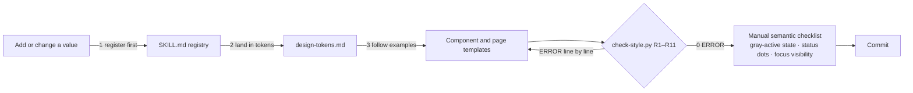

<!-- chatgptfrontend-style-guard · README (English) · doc v3 · spec v2.2 · 2026-11-06 -->

# chatgptfrontend-style-guard

> **A front-end style guard — making every line of style an AI writes traceable and enforceable.**

[中文](README.md) · [English](README_EN.md)

    

**openaistack-frontend-style** (style name: **OpenaiStack**) — a UI design specification packaged as a skill that AI agents can execute and machines can audit. Works for HTML / CSS / TS / JS / Vue / React front-end development.

---

## Table of Contents

- [Why you need this](#why-you-need-this)
- [Understand it in 60 seconds](#understand-it-in-60-seconds)
- [Quick start](#quick-start)
- [Install into your agent with one command](#install-into-your-agent-with-one-command)
- [Permanently set your agent's design style](#permanently-set-your-agents-design-style)
- [See it work: a real example](#see-it-work-a-real-example)
- [Repository structure](#repository-structure)
- [Design tokens at a glance](#design-tokens-at-a-glance)
- [Guard rules R1–R11](#guard-rules-r1r11)
- [Context cost](#context-cost)
- [FAQ](#faq)
- [Version history](#version-history)
- [License & credits](#license--credits)

## Why you need this

Ask an AI to write front-end code ten times, and nine of those times it will **drift into literals**: this round it remembers to use a token for the primary color; the next round it casually types a raw hex value. "Just emphasize it in the prompt" doesn't hold — a prompt is a probabilistic constraint, and violations accumulate round by round.

OpenaiStack upgrades a style spec from "prompt guidance" into a three-layer mechanism:

1. **Registry**: `SKILL.md` §1 is the single source of truth for every token. Literal values are forbidden in component code; any new value must be **registered first, then landed, then used** — otherwise the checker blocks it.
2. **Deterministic gating**: `scripts/check-style.py` (rules R1–R11) scans mechanical items line by line before every commit — color, spacing, radius, font size, duration, z-index, token reference. Detection never depends on the model's good behavior.
3. **Positive examples**: 14 component templates + 5 page skeletons + a full test page, so every generation has a compliant reference instead of only a list of prohibitions.

And none of the values were invented — every single one was **measured from the KnowWork v0.0.2 front-end source code and compiled bundle** (the base being OpenAI's open-source ChatGPT design system, `@openai/apps-sdk-ui`). The evidence chain lives in `references/knowwork-analysis.md`.

## Understand it in 60 seconds



In one sentence: **the registry defines what is legal, the checker guarantees that anything illegal is caught, and the templates let the AI write it right the first time.**

## Quick start

### Option 1: let an AI agent develop under this spec (recommended)

Hand the whole directory to any AI agent (Claude / GPT / TeleAgent / Cursor all work) and drive it with two prompts:

**Develop a new component / page:**

```text
Read SKILL.md in the project root first; all styles in this task must strictly follow
the OpenaiStack style. Task: [describe the task].
Before finishing, run "python scripts/check-style.py" to verify 0 ERROR, and attach a
report of which tokens you used.
```

**Pre-commit review:**

```text
Run "python scripts/check-style.py <changed-dir>" first; fix every ERROR and confirm
each INFO item. Then review the semantic items against SKILL.md §5 step two (gray
active state / status dots / z-index / focus / no nested cards), and list every fix.
```

### Option 2: manual workflow

```bash
# Pre-commit review (exit code 1 on ERROR — wire it straight into CI / pre-commit)
python scripts/check-style.py .

# Preview the golden sample (full test page: palette / components / typography /
# overlays / motion / light-dark themes / extension-name icon tester)
# just double-click demo/openaistack-v2-test.html
```

### Adopting into a real project

See `references/framework-adapters.md`:

- **React**: install `@openai/apps-sdk-ui` directly (Route A — tokens and components work out of the box);
- **Tailwind v4 / Vue**: land the tokens via Route B (`@theme inline`) in `references/design-tokens.md`;
- **Plain HTML/CSS**: copy the Route B variables; hand-written classes reference `var()` only.

## Install into your agent with one command

This repository is packaged per the open [Agent Skills spec](https://agentskills.io) (a standard `SKILL.md` front-matter at the root), so Vercel's `skills` CLI can pull it in one line (requires Node.js 22.20+):

```bash
# Install into the current project (recommended); -a picks target agents, repeatable
npx skills add Shawn-1211/chatgptfrontend-style-guard -a claude-code -a codex -a cursor

# Install globally (available across projects)
npx skills add Shawn-1211/chatgptfrontend-style-guard -g

# Omit -a: auto-detect installed agents and let you choose
npx skills add Shawn-1211/chatgptfrontend-style-guard
```

Supports Claude Code, Codex, Cursor, OpenCode, Gemini CLI, GitHub Copilot and 75+ more agents (full list and install paths at [vercel-labs/skills](https://github.com/vercel-labs/skills)). Once installed, just tell your agent "follow the OpenaiStack style" or "run check-style" to trigger it.

Management commands: `npx skills list` (installed) / `npx skills check` (updates) / `npx skills update` (upgrade) / `npx skills remove` (uninstall).

## Permanently set your agent's design style

Installing the skill only makes it *triggerable*; to make the agent **enforce this spec on every front-end task, in every project**, write the declaration below into your agent's instruction file (each tool's persistent-memory entry point):

| Agent | Instruction file | Scope |
| --- | --- | --- |
| Claude Code | `CLAUDE.md` (project root) / `~/.claude/CLAUDE.md` (global) | this project / all projects |
| Codex | `AGENTS.md` (project root) / `~/.codex/AGENTS.md` (global) | this project / all projects |
| Cursor | `.cursor/rules/*.mdc` (project) / global Rules settings | this project / all projects |
| OpenCode | `AGENTS.md` (project root) | this project |
| TeleAgent | copy the whole package into the skills directory (see FAQ Q6) | auto-triggered globally |

Declaration to paste:

```markdown
## Front-end style policy (OpenaiStack)

All front-end code in this project must follow the OpenaiStack style spec (chatgptfrontend-style-guard):

1. Read `SKILL.md` in the project root before starting (the single source of truth for tokens and rules);
2. Use only registered tokens / Tailwind semantic classes — no hard-coded hex, no unregistered spacing/radius/font-size/duration/z-index;
3. Run `python scripts/check-style.py <changed-dir>` before every commit; 0 ERROR required;
4. New values: register in `SKILL.md` §1 → sync `references/design-tokens.md` → then use.
```

Once written, the agent loads the spec automatically on every front-end task — no more repeating it in prompts, and no style drift across long conversations.

## See it work: a real example

An AI casually writes this (a very typical round of drift):

```html
<div class="shadow-lg duration-300" style="color:#4b5563; padding:18px; border-radius:15px; z-index:99">
  <span class="text-3xl">标题</span>
</div>
```

Run `python scripts/check-style.py`. This is the **real output** of the checker (messages are currently Chinese; rule IDs, line numbers and positions are universal):

```text
demo/example.html:2  [ERROR] [R1-硬编码颜色] #4b5563 → 替换为 SKILL.md §一 语义类名/Token
demo/example.html:2  [ERROR] [R2-间距网格] padding: 18px，不在 4px 网格登记档（或 0/auto）
demo/example.html:2  [ERROR] [R3-圆角白名单] border-radius: 15px，只允许登记档 2/4/6/8/10/12/16/20/24
demo/example.html:2  [ERROR] [R7-阴影体系] shadow-lg 未登记；只允许 shadow-100/200/300/400（浮层）或 shadow-none
demo/example.html:2  [ERROR] [R9-时长档] duration-300 未登记；时长档仅 150/160/180/200/220/350ms
demo/example.html:2  [ERROR] [R10-层级白名单] z-index: 99 未登记；层级档仅 1000(遮罩)/1001(对话框·抽屉)/1100(菜单·气泡)/2000(轻提示)
demo/example.html:3  [ERROR] [R5-字号分级] text-3xl 超出登记档（UI 允许 xs/sm/base/lg/xl/2xl，标题用登记 px 值）
```

Seven violations, each located by file and line, each with a fix direction. Switch to registered values and it goes to 0 ERROR:

```html
<div class="rounded-lg border border-border bg-surface p-4 duration-150" style="z-index: 1100">
  <span class="text-xl text-foreground">标题</span>
</div>
```

Every value in the fixed code (radius 10, alpha border, padding 16, duration 150, z-index 1100, font size 20) can be found as a registered row in `SKILL.md` §1 — **that is what "traceable" means here.**

## Repository structure

```
chatgptfrontend-style-guard/
├── SKILL.md                       # Single source of truth: YAML front-matter + token registry + rules + checklist
├── README.md                      # This project's README (Chinese)
├── README_EN.md                   # English README
├── LICENSE                        # MIT license
├── references/
│   ├── knowwork-analysis.md       # Measured evidence: architecture, full token values, v1→v2 diffs, disposal log
│   ├── design-tokens.md           # Token landing: Route A/B, semantic class quick reference
│   ├── component-library.md       # v2 component templates ×14 (incl. sidebar submenu)
│   ├── page-templates.md          # v2 page skeletons ×5
│   └── framework-adapters.md      # React/Vue/plain-HTML adapters + file-icon registry (§7)
├── scripts/
│   └── check-style.py            # Deterministic guard R1–R11 (pure stdlib, zero dependencies)
└── demo/
    └── openaistack-v2-test.html    # v2 golden sample & full test page (double-click to preview)
```

## Design tokens at a glance (v2)

| Dimension | Registered values |
| --- | --- |
| Neutral grays | 16-step pure gray ramp, light `#ffffff→#0d0d0d`, fully inverted in dark; **borders use alpha** (black 5%/10%/15% light, white in dark) |
| Primary button | Black `#181818` (auto-inverts to white-on-black in dark theme); soft secondary `#ededed` |
| Semantic colors | info `#0285ff` · success `#00a240` · danger `#e02e2a` · warning `#e25507` · discovery purple `#924ff7` · link `#2b7de9` |
| Sidebar | 260px (collapses to 60px); **active state = light gray fill, colored fills forbidden**; bottom-left = user menu (settings live inside the menu) |
| Radius | 2/4/6/8/10/12/16/20/24 + full (controls 8, cards 12, dialogs 16, badges 4) |
| Spacing | 4px base grid + half-steps 6/10/14 + micro-gaps 2/3 |
| Font sizes | UI scale 12/13/**14 (base)**/15/16/18/20 + heading scale 24–72 |
| Shadows | elevation 100–400 + hairline; cards are shadow-free, layered by alpha borders |
| Motion | default 150ms; overlay tiers 160/180/200/220ms; four measured easing curves; full `prefers-reduced-motion` degradation |
| Status visibility | 6px semantic dots + text (not solid badges); z-index tiers 1000/1001/1100/2000 |

## Guard rules R1–R11

| Rule | Checks | Verdict |
| --- | --- | --- |
| R1 | Hard-coded colors (`#hex` / `rgb()` / `hsl()`) | ERROR (token layer exempt; all-digit `#123` downgraded to INFO as probable ID) |
| R2 | Spacing grid (4px base + half-steps) | ERROR |
| R3 | Radius registry | ERROR (`full` → INFO circle confirmation) |
| R4 | Arbitrary-value syntax `[..px]` | ERROR |
| R5 | Font-size registry | ERROR |
| R6 | Decorative gradients | ERROR |
| R7 | Shadow system (elevation variables + hairline only) | ERROR |
| R8 | Background images via `url()` | INFO, human confirmation |
| R9 | Duration registry (150/160/180/200/220/350ms) | ERROR |
| R10 | z-index tier whitelist | ERROR |
| R11 | Token reference registry (`var(--xxx)` must be registered; enforced on the spec docs themselves) | ERROR |
| — | Semantic items (gray active state / status dots / focus / icon style / nested cards) | emitted as a manual review checklist |

> **Single source of truth**: `SKILL.md` §1 is the sole authority for token names and values; `references/design-tokens.md` is only the landable copy, `references/knowwork-analysis.md` is only the evidence draft — any conflict resolves to SKILL.md (R11 guards the reference names).

## Context cost

Designed with **progressive disclosure** for AI agents — only one SKILL.md stays resident; everything else loads on demand:

| Layer | Content | Est. tokens | When loaded |
| --- | --- | --- | --- |
| Resident | SKILL.md | ≈ 4.7K | on trigger |
| On demand | references ×5 (2.3–3.5K each) | ≈ 14K total | whichever the nav table points to |
| Execute only | check-style.py | ≈ 4.8K | never enters context; only its output does |
| Never loaded | golden sample HTML | ≈ 16K | browser preview |

Typical task cost: component work ≈ 8–10K; pre-commit review ≈ resident + 0.3K.

## FAQ

**Q1: Why not just write "use blue #3b82f6 and multiples of 8" in the prompt?**
A prompt is probabilistic: the AI mostly obeys and occasionally drifts — and drift tends to land in the commit nobody re-reviews. OpenaiStack's registry + checker are deterministic: 7 violations are exactly 7 ERRORs, exit code 1, CI blocks it.

**Q2: Where do these values come from? Who decided?**
Not taste — measurement. Every v2 value was reverse-engineered from the KnowWork front-end (base = the official ChatGPT design system) source code and compiled bundle. Method and raw data are in `references/knowwork-analysis.md`, reproducible. v1 was based on a different design guide; after comparing against the real product, the two systems turned out inconsistent, so v1 was deprecated and rewritten.

**Q3: Can I change the token values?**
Yes — but through one path only: register in `SKILL.md` §1 → sync `references/design-tokens.md` → then use. The checker blocks any unregistered value, so "changed but not registered" is exposed immediately.

**Q4: What about new file formats (say .md, .dwg)?**
Use the registry (`references/framework-adapters.md` §7): same category reuses its color (md is a document — zero new colors); a new category registers a semantic color first via the registration path (that's how CAD purple arrived); unregistered formats fall back to neutral gray automatically — every new format gets a correct representation instantly, never a missing icon.

**Q5: How is this different from stylelint / ESLint?**
Linters check *how* code is written (semicolons, ordering, selector complexity); OpenaiStack checks the *value system* (is this blue the registered blue, is this spacing on the grid, is this z-index authorized) and integrates natively with AI workflows: registry discipline, on-demand templates, a manual semantic checklist. They coexist fine.

**Q6: How do I turn this into an auto-triggered TeleAgent skill?**
`SKILL.md` already carries YAML front-matter (`name: openaistack-frontend-style`). Copy the whole package into the TeleAgent skills directory and it triggers on keywords like "OpenaiStack / 前端风格 / check-style"; currently it is referenced manually within the project.

## Version history

- **v2.3 (2026-11-06)** — sidebar submenu: measured addition of group/tree navigation (row-start 20×20 toggle on first-level items, ChevronDown/Right icon swap with no rotation; child indent `depth*16+4`, in-tree selected state surface-tertiary, expanded by default, WAI-ARIA tree mode); §1.5 registers the tree-indent formula; component-library adds §14, page-templates skeleton synced, golden sample tested.
- **v2.2 (2026-11-05)** — guard hardening: added R11 token-reference registry check (`var(--xxx)` names must be registered; enforced on the spec docs themselves); established a single-source-of-truth contract (token names and values live only in SKILL.md §1; references are landable/evidence copies).
- **v2.1 (2026-11-05)** — audit round: four easing curves, 350ms slow tier, focus / z-index / form-state rules, R10 z-index whitelist, R9 extended to animation; component library and page skeletons fully rewritten for v2; all v1 demos removed, package slimmed to 10 files.
- **v2 (2026-11-05)** — base switch: from the KnowFlow blue system to **KnowWork measurements** (the official ChatGPT design system); every token rewritten with a traceable evidence chain.
- **v1 (2026-11-05, deprecated)** — initial version based on the KnowFlow redesign guide (blue `#3b82f6` / slate grays / 8px-only grid / 200ms / colored active states); reference only when maintaining legacy KnowFlow.

## License & credits

- This repository is open-sourced under the [MIT license](LICENSE); use, modify and redistribute freely (keep the copyright and license notice).
- The v2 base is OpenAI's open-source ChatGPT design system, [`@openai/apps-sdk-ui`](https://www.npmjs.com/package/@openai/apps-sdk-ui) (MIT). This repository performed a full token extraction against its v0.0.2 build — method, raw data and diff analysis live in `references/knowwork-analysis.md`.
- The checker currently emits Chinese-language messages; localization contributions are welcome.
